# SheetXpert 2.0

Ficha técnica del equipo en un clic: recopila información del sistema, la muestra en una interfaz
gráfica (español / inglés) y la exporta a **PDF**, TXT o JSON.
*One-click system technical sheet with a GUI (Spanish / English) and PDF / TXT / JSON export.*

```
SheetXpert/
├── windows/            ← versión para Windows 10/11
│   ├── SheetXpert.py
│   ├── run_windows.bat       (ejecutar desde el código)
│   ├── build_windows.bat     (genera dist\SheetXpert.exe)
│   ├── requirements.txt
│   └── assets/
├── linux/              ← versión para cualquier distribución Linux
│   ├── sheetxpert.py
│   ├── run.sh                (ejecutar sin instalar)
│   ├── install.sh / uninstall.sh
│   ├── build_linux.sh        (binario único con PyInstaller)
│   ├── requirements.txt
│   └── assets/
├── docs/               ← animaciones de terminal del README (SVG) y su generador
├── .github/workflows/build.yml   (compila .exe y binario Linux en GitHub)
├── LICENSE
└── README.md
```

## Índice

1. [Novedades de la versión 2.0](#novedades-de-la-versión-20)
2. [Instalación en Windows, paso a paso](#instalación-en-windows-paso-a-paso)
3. [Instalación en Linux, paso a paso](#instalación-en-linux-paso-a-paso)
4. [Datos que recoge](#datos-que-recoge) · [Estado de las pruebas](#estado-de-las-pruebas) · [Licencia](#licencia)
5. [English summary](#english-summary)

---

## Novedades de la versión 2.0

- **Versión Linux completa**: lee `/proc` y `/sys` directamente, así que no depende de ninguna distro
  concreta; solo usa herramientas externas (`ip`, `nmcli`, `lspci`…) si están instaladas.
- **Windows mucho más rápido**: una sola llamada a PowerShell que devuelve JSON, en lugar de ~30 procesos
  (y sin ventanas de consola parpadeando).
- **PDF con Unicode real**: tildes, ñ y símbolos ya no salen como `?` (fuente DejaVu incluida).
  PDF rediseñado con logo, secciones, tabla de discos y pie con número de página.
- **Interfaz mejorada**: informe por secciones, botones *Exportar PDF*, *Guardar TXT/JSON* y *Copiar*,
  cambio de idioma en vivo (también re-traduce el informe ya generado) e idioma inicial según el sistema.
- **Modo consola** (`--cli`, `--json`, `--pdf`) para servidores sin entorno gráfico.
- **Datos nuevos**: kernel, arquitectura, uptime, GPU, núcleos/hilos, placa base, fecha de BIOS,
  salud y ciclos de batería, virtualización, escritorio y sesión (Linux), estado real del cortafuegos.
- **Correcciones**: el firewall de Windows siempre salía «Unknown»; la batería mostraba códigos numéricos;
  la resolución de pantalla salía vacía en muchos equipos; los recursos se buscaban en el directorio
  actual (fallaba al lanzar desde otra carpeta y con mayúsculas/minúsculas en Linux); ya no se usa
  `shell=True`; los datos se recogen en un hilo sin tocar Tk desde fuera del hilo principal.
- Se eliminan los emojis de los botones (en Linux sin fuente emoji se veían como cuadrados).

> El flujo cambia ligeramente: antes se abría el diálogo de guardado nada más recopilar; ahora primero
> ves el informe y luego eliges exportar.

---

---

## Instalación en Windows, paso a paso

Hay tres caminos. Elige uno:

| Quiero… | Camino | Necesita Python |
|---|---|---|
| Probarlo ya | **A.** Ejecutar desde el código (`run_windows.bat`) | Sí |
| Un `.exe` que pueda llevar a otros PCs | **B.** Generarlo en tu equipo (`build_windows.bat`) | Sí, solo para compilar |
| Un `.exe` sin instalar nada | **C.** Compilarlo en GitHub Actions | No |

### Paso 1 · Instalar Python (solo para los caminos A y B)

1. Descarga **Python 3.8 o superior** desde <https://www.python.org/downloads/>.
2. Ejecuta el instalador y **marca la casilla «Add python.exe to PATH»** antes de pulsar *Install Now*.
3. Abre una consola (`Win` + `R`, escribe `cmd`, Intro) y comprueba la versión:

```bat
python --version
```

Si Windows responde que `python` no se reconoce como comando, reinstala Python marcando la casilla del PATH o prueba con `py -3 --version`
(los scripts `.bat` usan el lanzador `py` si existe).

### Paso 2 · Descargar el proyecto

**Opción 1 — con `git clone` (recomendada: luego se actualiza con un solo comando)**

1. Instala Git para Windows si no lo tienes: <https://git-scm.com/download/win> (vale con las opciones por defecto), o desde una consola:

```bat
winget install --id Git.Git -e
```

2. Cierra y abre la consola de nuevo y comprueba que funciona: `git --version`.
3. Clona el repositorio en la carpeta donde quieras (por ejemplo `Descargas`) y entra en la versión de Windows:

```bat
cd %USERPROFILE%\Downloads
git clone https://github.com/ContactAlexey/SheetXpert.git
cd SheetXpert\windows
```

<p align="center">
  
</p>

Para actualizar más adelante, dentro de la carpeta `SheetXpert`:

```bat
git pull
```

**Opción 2 — sin Git (ZIP)**

1. Descarga `SheetXpert.zip` (en GitHub: **Code → Download ZIP**) y haz clic derecho → **Extraer todo…** (por ejemplo en `Descargas`).
2. Entra en la carpeta `SheetXpert\windows`. Todo lo que sigue se hace desde ahí.

### Camino A · Ejecutar desde el código

**Con el ratón:** doble clic en `windows\run_windows.bat`. La primera vez instala `fpdf2` (hace falta internet una sola vez);
después abre la ventana directamente.

**Desde la consola**, que además te deja ver lo que ocurre:

```bat
cd SheetXpert\windows
python --version
run_windows.bat
```

<p align="center">
  
</p>

> Si la ventana de SheetXpert no aparece, ejecuta `python SheetXpert.py --cli` desde esa misma carpeta: verás el error
> en la consola en lugar de perderlo.

### Camino B · Generar `SheetXpert.exe`

1. Doble clic en `windows\build_windows.bat` (o ejecútalo desde la consola, como abajo).
2. Espera entre uno y tres minutos: instala `pyinstaller`, empaqueta el programa y acaba con el mensaje `Done:`.
3. El resultado queda en `windows\dist\SheetXpert.exe`. Es un único archivo que puedes copiar a cualquier PC con Windows 10/11, sin Python.

```bat
cd SheetXpert\windows
build_windows.bat
```

<p align="center">
  
</p>

> **Aviso de SmartScreen:** el `.exe` no está firmado digitalmente, así que Windows puede mostrar «Windows protegió su PC».
> Pulsa **Más información → Ejecutar de todas formas**. Es normal en ejecutables creados con PyInstaller.

### Camino C · Obtener el `.exe` sin instalar Python (GitHub Actions)

Si el proyecto está en tu repositorio de GitHub:

1. Abre la pestaña **Actions** → **Build binaries** → botón **Run workflow**.
2. Espera a que el trabajo termine (marca verde).
3. Entra en esa ejecución y, al final de la página, en **Artifacts**, descarga **SheetXpert-windows**.
4. Descomprime el ZIP descargado: dentro está `SheetXpert.exe`.

(El workflow también se lanza solo al publicar una etiqueta que empiece por `v`, por ejemplo `v2.0.0`.)

### Uso por línea de comandos

```bat
python SheetXpert.py --cli                  :: ficha en texto
python SheetXpert.py --json                 :: datos en JSON
python SheetXpert.py --pdf ficha.pdf        :: PDF sin abrir ventana
python SheetXpert.py --lang en              :: forzar idioma (es / en)
```

<p align="center">
  
</p>

El `.exe` se compila con `--windowed` (sin consola), por lo que las opciones `--cli/--json` no muestran
salida en él; úsalas con `python SheetXpert.py`.

### Problemas frecuentes en Windows

| Síntoma | Solución |
|---|---|
| `Python 3.8 or newer was not found` | Instala Python y marca *Add python.exe to PATH*; abre una consola nueva. |
| `Could not install the dependencies` | Comprueba la conexión a internet (solo hace falta la primera vez) y vuelve a ejecutar el `.bat`. |
| Algún dato sale vacío | Ejecuta `python SheetXpert.py --json` y revisa qué campo falta. |
| El `.exe` no abre por SmartScreen | *Más información → Ejecutar de todas formas*. |

---

## Instalación en Linux, paso a paso

Hay tres caminos. Elige uno:

| Quiero… | Camino | Necesita Python |
|---|---|---|
| Probarlo sin instalar nada | **A.** `./run.sh` | Sí |
| Icono en el menú de aplicaciones y comando `sheetxpert` | **B.** `./install.sh` | Lo instala si falta |
| Un binario único para llevar a otros equipos | **C.** `./build_linux.sh` o GitHub Actions | Solo para compilar |

### Paso 1 · Comprobar los requisitos (caminos A y C)

Hace falta **Python 3.8+** y, para la interfaz gráfica, **tkinter**. El PDF usa `fpdf2` (lo instalan los scripts).
Si vas a usar el camino B, sáltate este paso: `install.sh` instala lo que falte.

```bash
python3 --version
python3 -c 'import tkinter' && echo 'tkinter OK'
```

Si falta tkinter, instálalo con el gestor de tu distribución:

| Distribución | Comando |
|---|---|
| Debian, Ubuntu, Mint, Pop!_OS, Kali… | `sudo apt install python3 python3-venv python3-tk` |
| Fedora, RHEL, Rocky, Alma, CentOS Stream | `sudo dnf install python3 python3-tkinter` |
| Arch, Manjaro, EndeavourOS | `sudo pacman -S python tk` |
| openSUSE | `sudo zypper install python3 python3-pip python3-tk` |
| Alpine | `sudo apk add python3 py3-pip python3-tkinter` |
| Void | `sudo xbps-install -S python3 python3-tkinter` |
| Gentoo y otras | instala Python con soporte Tk manualmente (`USE=tk`) |

Sin tkinter el programa sigue funcionando en modo texto (`--cli`), pero no abre la ventana.

### Paso 2 · Descargar el proyecto

**Opción 1 — con `git clone` (recomendada: luego se actualiza con un solo comando)**

1. Instala Git si no lo tienes y comprueba la versión:

| Distribución | Comando |
|---|---|
| Debian, Ubuntu, Mint, Pop!_OS, Kali… | `sudo apt install git` |
| Fedora, RHEL, Rocky, Alma, CentOS Stream | `sudo dnf install git` |
| Arch, Manjaro, EndeavourOS | `sudo pacman -S git` |
| openSUSE | `sudo zypper install git` |
| Alpine | `sudo apk add git` |
| Void | `sudo xbps-install -S git` |

```bash
git --version
```

2. Clona el repositorio y entra en la versión de Linux:

```bash
cd ~
git clone https://github.com/ContactAlexey/SheetXpert.git
cd SheetXpert/linux
```

<p align="center">
  
</p>

Los `.sh` conservan su permiso de ejecución al clonar. Para actualizar más adelante, dentro de la carpeta `SheetXpert`:

```bash
git pull
```

Si ya habías instalado con `./install.sh`, vuelve a ejecutarlo tras el `git pull` para copiar la versión nueva.

**Opción 2 — sin Git (ZIP)**

```bash
cd ~/Descargas
unzip SheetXpert.zip
cd SheetXpert/linux
```

Si al ejecutar un script aparece `Permission denied`, dale permiso de ejecución:

```bash
chmod +x run.sh install.sh uninstall.sh build_linux.sh
```

### Camino A · Sin instalar nada (`run.sh`)

```bash
cd SheetXpert/linux
./run.sh
```

La primera vez, si falta `fpdf2`, crea un entorno virtual local `.venv` dentro de la carpeta `linux` (hace falta internet una vez).
Las siguientes ejecuciones abren la ventana al instante. Para borrarlo todo, elimina la carpeta.

<p align="center">
  
</p>

### Camino B · Instalar con icono en el menú (`install.sh`)

**Instalación de usuario** (recomendada; no toca el sistema salvo para instalar paquetes que falten):

```bash
cd SheetXpert/linux
./install.sh
sheetxpert              # o búscalo en el menú de aplicaciones: «SheetXpert»
```

El instalador detecta el gestor de paquetes (`apt`, `dnf`, `yum`, `zypper`, `pacman`, `apk`, `xbps`), instala Python + venv + tkinter
si faltan (te pedirá la contraseña de `sudo` solo en ese momento), copia el programa a `~/.local/share/sheetxpert`, crea su entorno virtual
con `fpdf2` y registra el comando `sheetxpert` y el lanzador del menú.

<p align="center">
  
</p>

> Si al final aparece el aviso de que `~/.local/bin` no está en el PATH, añade esto a tu `~/.bashrc` (o `~/.zshrc`) y abre una terminal nueva:
> ```bash
> export PATH="$HOME/.local/bin:$PATH"
> ```

**Instalación para todos los usuarios** (en `/opt` y `/usr/local/bin`):

```bash
sudo ./install.sh --system
```

<p align="center">
  
</p>

**Opciones del instalador**

| Opción | Efecto |
|---|---|
| `--system` | Instalación global (necesita `sudo`). |
| `--no-deps` | No toca el gestor de paquetes (tú instalas Python, venv y tkinter). |
| `-h`, `--help` | Muestra la ayuda. |

**Desinstalar** (usa la misma opción con la que instalaste):

```bash
./uninstall.sh                 # instalación de usuario
sudo ./uninstall.sh --system   # instalación global
```

<p align="center">
  
</p>

### Camino C · Binario único (sin Python en el equipo de destino)

**Compilarlo tú mismo:**

```bash
cd SheetXpert/linux
./build_linux.sh
./dist/sheetxpert --version
```

El resultado es `linux/dist/sheetxpert`. Para máxima compatibilidad compílalo en una distro antigua (Ubuntu 22.04 / Debian 11): funcionará en
esa versión de glibc y en las posteriores.

<p align="center">
  
</p>

**O compilarlo en GitHub Actions** (sin instalar nada en tu equipo):

1. Pestaña **Actions** → **Build binaries** → **Run workflow**.
2. Cuando acabe, entra en la ejecución y descarga **SheetXpert-linux-x86_64** desde **Artifacts**.
3. Descomprime el ZIP y dale permiso de ejecución (los artefactos de GitHub no conservan los permisos):

```bash
unzip SheetXpert-linux-x86_64.zip
chmod +x sheetxpert
./sheetxpert
```

El mismo workflow compila también el `.exe` de Windows y usa Ubuntu 22.04 como base.

### Uso por línea de comandos

También en servidores sin pantalla, donde pasa a modo texto automáticamente:

```bash
sheetxpert --cli              # ficha en texto
sheetxpert --json             # datos en JSON
sheetxpert --pdf ficha.pdf    # PDF sin abrir ventana
sheetxpert --lang en          # forzar idioma
```

<p align="center">
  
</p>

Si no la has instalado, sustituye `sheetxpert` por `./run.sh` (camino A) o `./dist/sheetxpert` (camino C).

### Problemas frecuentes en Linux

| Síntoma | Solución |
|---|---|
| `Permission denied` al ejecutar un `.sh` | `chmod +x *.sh` |
| `tkinter is not installed` / no abre la ventana | Instala el paquete de tkinter de tu distro (tabla del paso 1). Mientras tanto usa `--cli`. |
| `The Python 'venv' module is missing` | Debian/Ubuntu: `sudo apt install python3-venv`. |
| `sheetxpert: command not found` | Añade `~/.local/bin` al PATH (ver camino B) o abre una terminal nueva. |
| `pip could not install the dependencies` | Revisa tu conexión: `fpdf2` se descarga una vez. |
| Falta el PDF en `run.sh` | Mensaje `PDF export will be unavailable`: instala `python3-venv` y `python3-pip` y reintenta, o usa `./install.sh`. |

### Notas sobre Linux

- **Números de serie**: el kernel los restringe a root. Verás «(requiere permisos de administrador)».
  Para obtenerlos usa el modo consola: `sudo sheetxpert --cli` (la GUI como root suele fallar en Wayland).
- **Fecha de instalación**: Linux no la guarda; se estima (con `~`) a partir de la fecha de creación de `/`
  o de `machine-id`.
- **RAM**: es la que ve el kernel, algo menos que la instalada (memoria reservada).
- **SSID**: requiere NetworkManager (`nmcli`), `iwgetid` o `iw`; en equipos sin Wi-Fi no aparece.
- **GPU**: requiere `lspci` (paquete `pciutils`); si no existe se muestra el driver del kernel.
- **Cortafuegos**: detecta `firewalld`, `ufw` y `nftables` (sin root no se pueden leer reglas de iptables/nft).
- ARM / Raspberry Pi: se usa el device-tree para modelo y número de serie.

## Datos que recoge

| Sección | Windows | Linux |
|---|---|---|
| General | nombre, SO, versión/build, arquitectura, instalación, último arranque, uptime | nombre, distro, kernel, arquitectura, instalación (aprox.), arranque, uptime, escritorio, sesión, virtualización |
| Hardware | marca, modelo, placa, series, BIOS, CPU, núcleos/hilos, RAM, GPU, pantalla | ídem (DMI / device-tree) |
| Almacenamiento | discos locales | particiones reales montadas (sin tmpfs/snap/loop) |
| Red | IPv4 + interfaz, MAC, SSID | IPv4 + interfaz, MAC de la ruta por defecto, SSID |
| Batería | carga, estado, salud | carga, estado, salud, ciclos |
| Seguridad | Firewall de Windows (3 perfiles) | firewalld / ufw / nftables |

Todo se ejecuta en local; no se envía nada a terceros ni se recogen credenciales.

## Estado de las pruebas

- **Linux**: probado en Ubuntu 24.04 (contenedor): modo consola, JSON, PDF, GUI con pantalla virtual,
  instalador en un HOME limpio y binario PyInstaller. Los lectores de batería, Wi-Fi, IP, MAC, discos,
  cortafuegos y pantalla se probaron con datos simulados de `/sys`, `/proc` y de las herramientas.
  No se ha podido probar en otras distros reales.
- **Windows**: el código común (interfaz, PDF, informe) es el mismo que en Linux y se probó con datos
  simulados de PowerShell, pero **no se ha ejecutado en un Windows real**. Si algún dato sale vacío,
  ejecuta `python SheetXpert.py --json` y revisa qué campo falta.
- No se incluye el `SheetXpert.exe` antiguo (es la versión 1.x): genera uno nuevo con `build_windows.bat`.

## Licencia

Copyright (c) 2025 Alexey. Todos los derechos reservados. Uso personal y educativo; la modificación,
redistribución o uso comercial requiere autorización expresa. Ver [LICENSE](LICENSE).
La fuente DejaVu incluida en `assets/fonts` tiene su propia licencia libre (`LICENSE-DejaVu.txt`).

---

---

## English summary

**Windows** (Python 3.8+ with *Add python.exe to PATH*): `git clone https://github.com/ContactAlexey/SheetXpert.git` (or unzip the ZIP), then `windows\run_windows.bat` (run from source) or
`windows\build_windows.bat` (builds `windows\dist\SheetXpert.exe`); or get the `.exe` from GitHub Actions
(*Actions → Build binaries → Run workflow → Artifacts*). Unsigned `.exe`: SmartScreen → *More info → Run anyway*.
**Linux (any distro):** `git clone https://github.com/ContactAlexey/SheetXpert.git && cd SheetXpert/linux` (or unzip), then `./run.sh` (portable, no install) or `./install.sh` (menu entry + `sheetxpert` command; installs Python + tkinter
via apt/dnf/yum/pacman/zypper/apk/xbps; `sudo ./install.sh --system` for all users; `./uninstall.sh` to remove);
`./build_linux.sh` makes a single binary in `dist/`. If a script says `Permission denied`: `chmod +x *.sh`.
**Headless:** `sheetxpert --cli | --json | --pdf file.pdf [--lang es|en]`.

Highlights: distro-independent data collection from `/proc` and `/sys`; single-call PowerShell collector on Windows;
Unicode PDF (DejaVu bundled); live language switch; TXT/JSON export; headless mode. Serial numbers on Linux need
root (`sudo sheetxpert --cli`). Windows code paths were tested with simulated PowerShell output only, not on a real
Windows machine.
